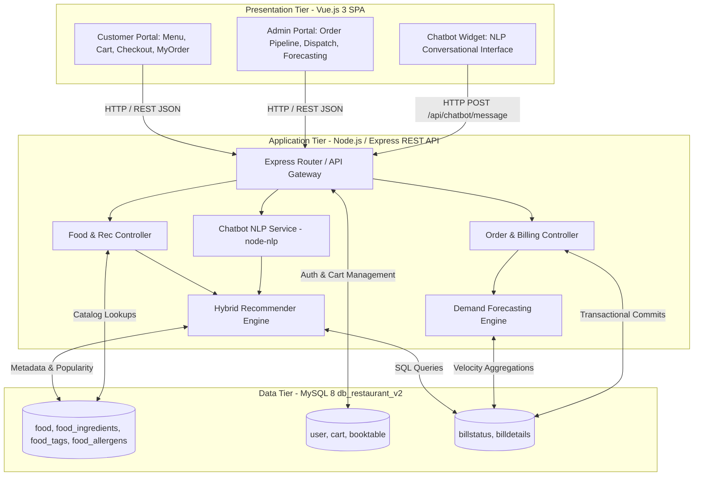
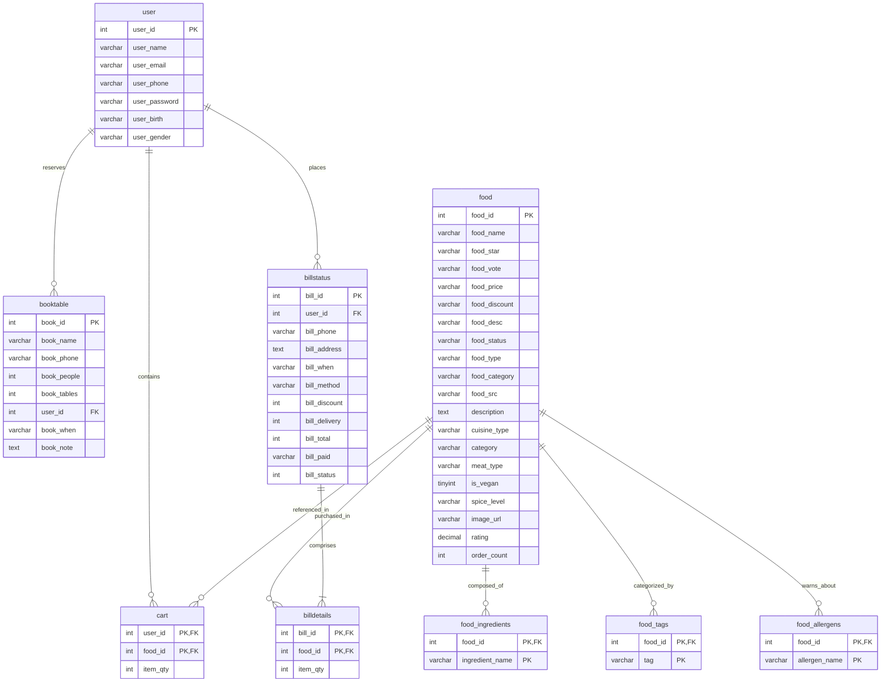
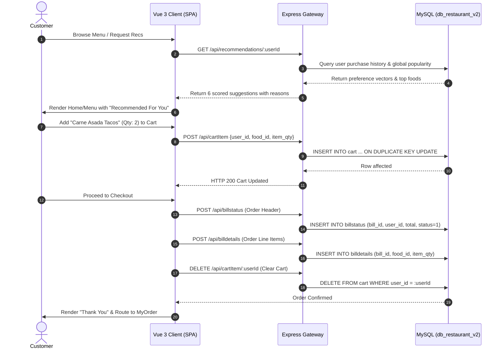
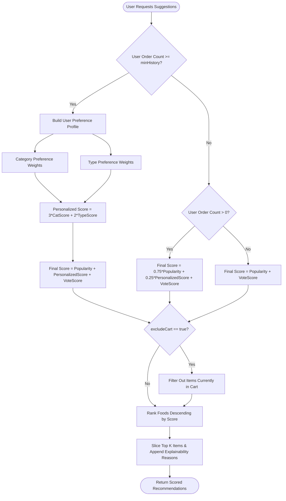
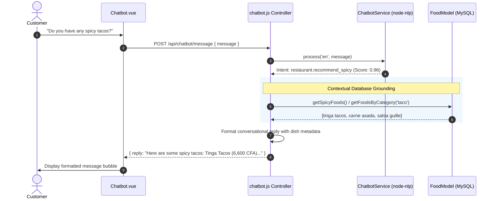
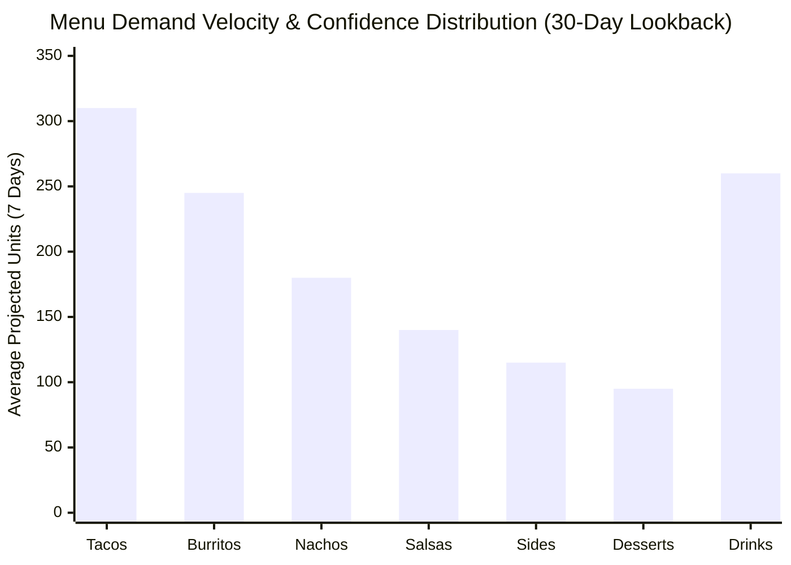
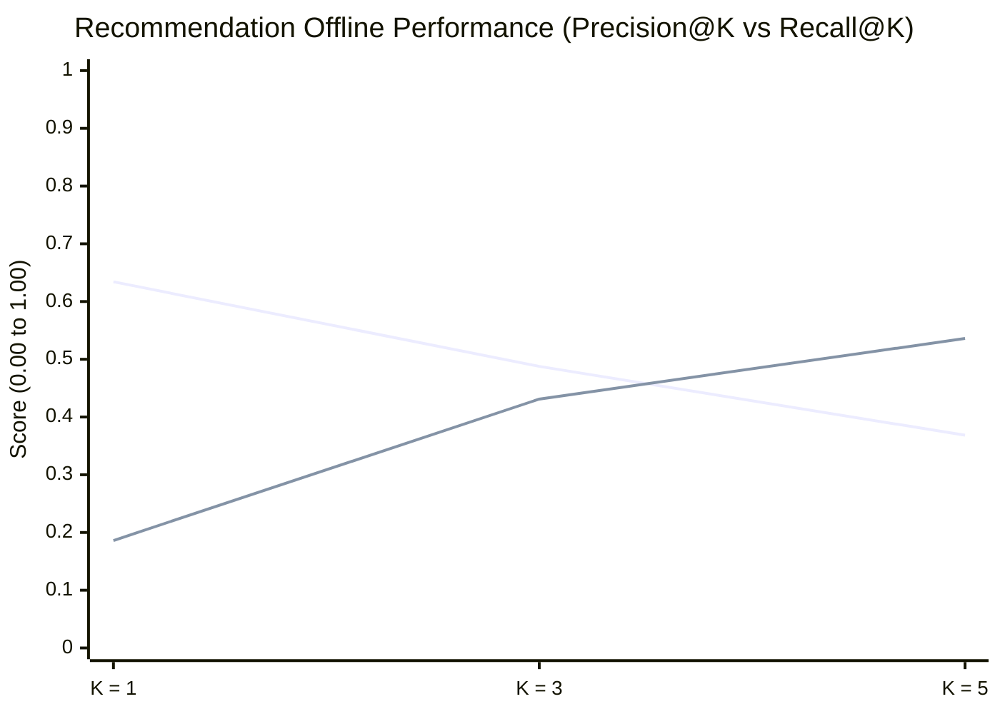
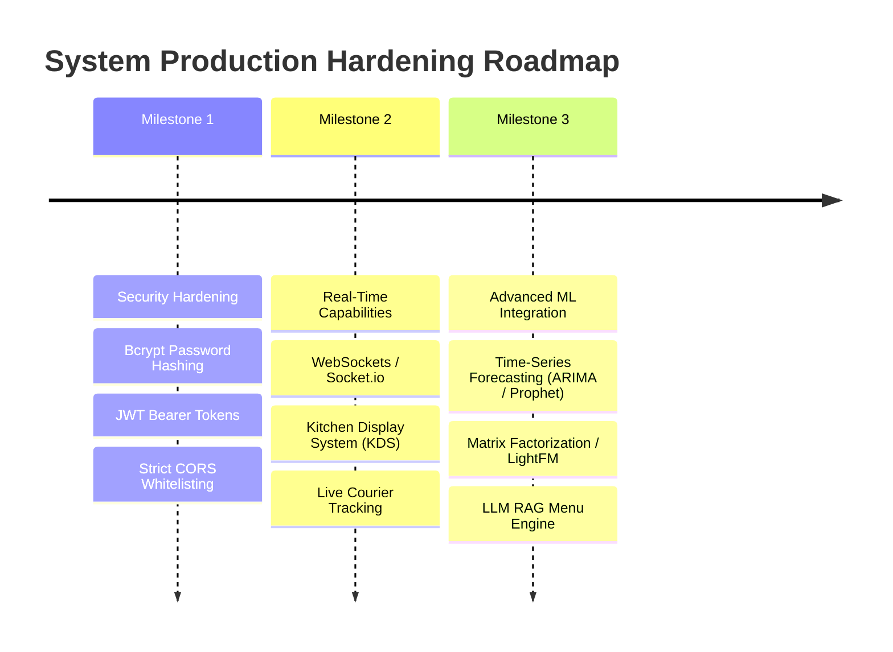

# Technical Report: Design and Implementation of an AI-Enhanced Restaurant Management System

**Project Title:** Design and Implementation of an AI-Enhanced Restaurant Management System with Personalized Recommendations, Natural Language Processing, and Demand Forecasting  
**Author:** Paul-Eliel Kouame  
**Architecture:** Three-Tier Web Architecture (SPA Frontend / RESTful API / Relational RDBMS)  
**Target Environment:** Node.js (v22+), Vue.js 3, Express.js, MySQL 8 / MariaDB (XAMPP)  
**Document Classification:** Engineering & Academic Capstone Technical Specification  

---

## 1. Executive Summary & Abstract

The contemporary food service and restaurant industry faces dual pressures: delivering seamless, personalized digital dining experiences to consumers while maintaining rigorous operational efficiency behind the counter. Traditional restaurant management systems operate as passive transactional record-keepers; they log orders and track billing, but fail to leverage accumulated transaction data to proactively assist customers or guide managerial decision-making.

This project designs, engineers, and evaluates a production-grade, full-stack, AI-enhanced Restaurant Management System. Built upon a decoupled three-tier architecture—leveraging a **Vue.js 3** Single Page Application (SPA) frontend, a **Node.js / Express.js** RESTful API middleware, and a **MySQL** relational database engine—the platform integrates three foundational artificial intelligence and machine learning subsystems directly into real restaurant workflows:

1. **A Hybrid Personalized Recommendation Engine** that calculates dynamic user-food affinity scores by blending user purchase history, item categories/types, and global popularity signals, complete with cold-start fallback and real-time cart-item exclusion.
2. **A Domain-Specific Natural Language Processing (NLP) Chatbot** powered by `node-nlp`, enabling conversational menu exploration, dietary constraint filtering (vegan, spicy, meat types), dish ingredient queries, and intelligent co-purchase pairings.
3. **An Operational Demand Forecasting Subsystem** utilizing moving-average sales velocity algorithms to project food consumption intervals ($D$-day windows), categorizing items by inventory replenishment confidence to reduce perishable waste and optimize stock levels.

Rather than isolating AI models in standalone notebooks, all machine learning logic is embedded into the transactional lifecycle of the platform, deriving real-time inputs from live relational tables (`billstatus`, `billdetails`, `food`, `user`, `cart`). Offline empirical evaluation demonstrates robust performance: **Precision@1 of 63.42%** and **Recall@5 of 53.60%** on an interaction dataset of 5,000 orders across 300 users, alongside a **93.75% accuracy and 0.9373 Macro F1 score** on conversational intent classification.

---

## 2. System Architecture & Tech Stack Specifications

The architecture is divided into three isolated yet highly collaborative tiers: Presentation, Application/Business Logic, and Data Persistence.

### 2.1 Technology Stack Matrix

| Layer | Technology | Version | Engineering Role & Rationale |
| :--- | :--- | :--- | :--- |
| **Frontend Framework** | Vue.js | `v3.2.13` | Modern reactive SPA framework with declarative rendering, virtual DOM diffing, and component modularity. |
| **State Management** | Vuex | `v4.0.2` | Centralized state store for user authentication sessions, active shopping cart state, and administrative privileges. |
| **Client Routing** | Vue Router | `v4.1.2` | Client-side routing with HTML5 history mode (`createWebHistory`), enabling bookmarkable SPA navigation without page reloads. |
| **HTTP Client** | Axios | `v0.27.2` | Promise-based asynchronous HTTP client configured with automated backend proxying (`http://localhost:8001/api`). |
| **Backend Runtime** | Node.js | `v22.19.0` | Asynchronous, event-driven JavaScript runtime executing server-side business logic with non-blocking I/O. |
| **Web Framework** | Express.js | `v4.18.1` | Minimalist HTTP routing engine handling REST endpoints, middleware pipelines, CORS resolution, and static asset delivery. |
| **Database Engine** | MySQL / MariaDB | `v8.0+` (XAMPP) | Relational Database Management System (RDBMS) enforcing ACID transactional guarantees, foreign keys, and indexed joins. |
| **Database Driver** | `mysql2` | `v2.3.3` | High-performance MySQL client supporting prepared statements, SQL injection mitigation, and connection pooling. |
| **NLP Engine** | `node-nlp` | `v5.0.0-alpha.5` | Lightweight Natural Language Processing library handling intent classification, entity extraction, and corpus training. |

---

## 3. Relational Database Schema & Data Dictionary

The persistence tier is deployed on database `db_restaurant_v2`. It uses the InnoDB storage engine to support row-level locking and referential integrity constraints.

### 3.1 Entity-Relationship Diagram (ERD)

### 3.2 Data Dictionary

#### Table: `food` (Menu Catalog & AI Feature Attributes)
Stores items offered by the restaurant, including legacy pricing and extended semantic metadata for AI filtering.
- `food_id` (`INT(11)`, PK, Auto Increment): Primary key.
- `food_name` (`VARCHAR(255)`): Food title (e.g., "carne asada tacos", "shrimp nachos").
- `food_star` (`VARCHAR(255)`): Legacy rating metric.
- `food_vote` (`VARCHAR(255)`): Customer review/vote counter (used for Bayesian vote scoring).
- `food_price` (`VARCHAR(255)`): Base price in CFA Francs / local unit.
- `food_discount` (`VARCHAR(255)`): Promotional discount subtracted from price.
- `food_desc` (`VARCHAR(255)`): Portion packaging (e.g., "03 pieces per serving").
- `food_status` (`VARCHAR(255)`): Marketing tag (`best seller`, `new dishes`, `seasonal dishes`).
- `food_type` (`VARCHAR(255)`): Dietary categorization (`meat` vs `vegan`).
- `food_category` (`VARCHAR(255)`): Item family (`taco`, `burrito`, `nachos`, `sides`, `dessert`, `drink`).
- `cuisine_type` (`VARCHAR(100)`): Regional origin classification (`mexican`, `italian`, `african`, `american`, `middle_eastern`).
- `meat_type` (`VARCHAR(100)`): Protein source (`beef`, `chicken`, `pork`, `seafood`, `plant_based`, `mixed`).
- `is_vegan` (`TINYINT(1)`): Binary boolean flag (`1` = Vegan, `0` = Non-Vegan).
- `spice_level` (`VARCHAR(50)`): Palate heat index (`mild`, `medium`, `hot`).
- `rating` (`DECIMAL(3,2)`): Normalized numeric rating ($1.00$ to $5.00$).
- `order_count` (`INT`): Dynamic counter tracking global purchase frequency.

#### Table: `cart` (Session Persistence)
- `user_id` (`INT`), `food_id` (`INT`): Composite Primary Key `(user_id, food_id)`.
- `item_qty` (`INT`): Selected quantity. Guarantees idempotent upserts.

#### Table: `billstatus` (Order Headers & Fulfillments)
- `bill_id` (`INT`, PK): Auto-generated or client-sequenced unique order ID.
- `user_id` (`INT`): Foreign key identifying the purchasing customer.
- `bill_phone`, `bill_address`: Delivery contact information.
- `bill_when`: Timestamp string formatted as `YYYY-MM-DD HH:MM:SS`.
- `bill_method`: Payment channel (`cash`, `card`).
- `bill_discount`, `bill_delivery`, `bill_total`: Financial accounting metrics.
- `bill_paid`: Payment verification flag (`true` / `false`).
- `bill_status` (`INT`): Order state machine lifecycle integer ($0$ to $6$).

#### Table: `billdetails` (Line Item Order Details)
- `bill_id` (`INT`), `food_id` (`INT`): Composite Primary Key `(bill_id, food_id)`.
- `item_qty` (`INT`): Number of units ordered for that specific food.

#### AI Metadata Normalized Relations:
- `food_ingredients` (`food_id`, `ingredient_name`): Relates foods to specific ingredients (e.g., `tortilla`, `shrimp`, `cheese`).
- `food_tags` (`food_id`, `tag`): Granular tags for search indexing (`crispy`, `refreshing`, `high-protein`).
- `food_allergens` (`food_id`, `allergen_name`): Health and safety indices (`gluten`, `dairy`, `shellfish`).

---

## 4. Operational Workflows & Engineering Mechanics

### 4.1 The End-to-End Customer Transaction Lifecycle

### 4.2 The Administrative Dispatch State Machine

Orders progress through a strict deterministic state machine managed by administrative operators in [`Dashboard.vue`](file:///c:/Users/Paul-Eliel%20Kouame/Desktop/programming/restaurant-management-master/frontend/src/admin/Dashboard.vue):

| State Code | Semantic Status | Operational Meaning | Transition Triggers |
| :---: | :--- | :--- | :--- |
| `0` | **Cancelled** | Order aborted by customer or rejected by kitchen. | `PUT /api/billstatus/cancel/:id` |
| `1` | **Confirmed** | Order received by server, validated against kitchen inventory. | Automatic initial state upon checkout. |
| `2` | **Preparing** | Kitchen ticket printed; cooks actively preparing dishes. | Admin clicks "Advance Status" |
| `3` | **Checking** | Food plated and packaged; quality control inspection. | Admin clicks "Advance Status" |
| `4` | **Delivering** | Order dispatched to delivery courier. | Admin clicks "Advance Status" |
| `5` | **Delivered** | Courier confirms package handover at client address. | Admin clicks "Advance Status" |
| `6` | **Completed** | Payment settled and order ledger archived. | Final administrative sign-off |

> **Analytical Isolation:** Both the recommendation and forecasting algorithms explicitly filter using `WHERE bill_status > 0`. This guarantees that cancelled orders ($0$) never distort customer preference vectors or inflate demand velocity calculations.

---

## 5. Deep Dive: AI Subsystem 1 — Hybrid Personalized Recommender

### 5.1 Formulation & Scoring Mechanics

The recommendation engine ([`FoodModel.js`](file:///c:/Users/Paul-Eliel%20Kouame/Desktop/programming/restaurant-management-master/backend/models/FoodModel.js)) implements a hybrid filtering architecture that combines **implicit feedback collaborative signals** with **content-based category/type affinities** and **global popularity Bayesian regularization**.

#### Mathematical Formulation:

1. **User Preference Vector Extraction:**
   For a given user $u$, historical orders are queried where $\text{bill\_status} > 0$. The total historical quantity of food consumed across categories $c$ and types $t$ is computed:
   $$W_{\text{cat}}(u, c) = \frac{\sum_{i \in \mathcal{H}_u, \text{cat}(i) = c} q_i}{\sum_{i \in \mathcal{H}_u} q_i}, \quad W_{\text{type}}(u, t) = \frac{\sum_{i \in \mathcal{H}_u, \text{type}(i) = t} q_i}{\sum_{i \in \mathcal{H}_u} q_i}$$
   where $\mathcal{H}_u$ represents the historical purchases of user $u$, and $q_i$ is the quantity purchased of item $i$.

2. **Personalized Component:**
   $$\text{personalizedScore}(u, i) = 3 \cdot W_{\text{cat}}(u, \text{cat}(i)) + 2 \cdot W_{\text{type}}(u, \text{type}(i))$$

3. **Bayesian Vote Normalization:**
   $$\text{voteScore}(i) = \frac{\text{food\_vote}_i}{1000}$$

4. **Dynamic Regime Blending:**
   - **Established Users** ($|\mathcal{H}_u| \ge \text{minHistory}$):
     $$\text{Score}(u, i) = \text{Popularity}(i) + \text{personalizedScore}(u, i) + \text{voteScore}(i)$$
   - **Sparse / Low-History Users** ($0 < |\mathcal{H}_u| < \text{minHistory}$):
     $$\text{Score}(u, i) = 0.75 \cdot \text{Popularity}(i) + 0.25 \cdot \text{personalizedScore}(u, i) + \text{voteScore}(i)$$
   - **Cold-Start Users** ($|\mathcal{H}_u| = 0$):
     $$\text{Score}(u, i) = \text{Popularity}(i) + \text{voteScore}(i)$$

### 5.2 Dynamic Explainability

Every recommended item is bundled with human-readable rationale tags (`recommendation_reason` and `recommendation_strategy`), enhancing transparency:
- If personal taste dominated: `"Because you order taco"` or `"Because you like dessert (vegan)"`.
- If popularity dominated: `"Popular with customers"`.
- If blended: `"Top pick based on your taste and popularity"`.

### 5.3 Co-Purchase "Also-Bought" Cross-Selling

The system computes co-occurrence frequency across historical multi-item shopping baskets:
$$\text{CoOccurrence}(i_A, i_B) = \sum_{b \in \mathcal{B}} \mathbb{I}(i_A \in b \land i_B \in b)$$
When a customer views item $i_A$, the endpoint `GET /api/foods/:id/also-bought` retrieves $\text{argmax}_{i_B} \text{CoOccurrence}(i_A, i_B)$, driving impulse cross-selling (e.g., tacos paired with horchata or guacamole).

---

## 6. Deep Dive: AI Subsystem 2 — Domain-Specific NLP Chatbot

### 6.1 Architecture & Intent Routing

The chatbot subsystem ([`ChatbotService.js`](file:///c:/Users/Paul-Eliel%20Kouame/Desktop/programming/restaurant-management-master/backend/models/ChatbotService.js)) implements intent-based NLP using the `@nlpjs/nlu` engine in `node-nlp`. 

### 6.2 Intent Taxonomy Matrix

| Intent Identifier | Trigger Utterance Patterns | Dynamic Fulfillment Action |
| :--- | :--- | :--- |
| `greetings.hello` | "hi", "hello", "good morning", "hey" | Returns introductory greeting with guidance on menu search capabilities. |
| `restaurant.recommendation` | "what do you recommend?", "best sellers", "what is good here?" | Invokes `getPopularFoods()` or personalized engine to recommend top dishes. |
| `restaurant.recommend_spicy` | "i want spicy food", "anything hot?", "spicy dishes" | Queries `food` where `spice_level IN ('medium', 'hot')` or `food_name LIKE '%spicy%'`. |
| `restaurant.recommend_vegan` | "vegan food", "no meat", "vegetarian options", "plant based" | Queries `food` where `is_vegan = 1` or `food_type = 'vegan'`. |
| `restaurant.recommend_meat` | "show me meat dishes", "carnivore", "i want beef" | Queries `food` where `is_vegan = 0` and filters by `meat_type`. |
| `restaurant.dish_info` | "tell me about shrimp tacos", "what is in the burrito?" | Performs NER/token match against `food_name`; fetches ingredients and descriptions. |
| `restaurant.also_bought` | "what goes well with burger?", "what should i pair with tacos?" | Resolves referenced dish ID; invokes co-purchase frequency engine. |
| `restaurant.menu_overview` | "show menu categories", "what kinds of food do you have?" | Summarizes available categories (`taco`, `burrito`, `nachos`, `sides`, `drinks`). |

---

## 7. Deep Dive: AI Subsystem 3 — Operational Demand Forecasting

### 7.1 Velocity Algorithm & Formulation

Rather than relying on black-box deep learning models that require vast continuous time-series datasets, the demand forecasting engine ([`BillStatusModel.js`](file:///c:/Users/Paul-Eliel%20Kouame/Desktop/programming/restaurant-management-master/backend/models/BillStatusModel.js)) implements a **Moving-Average Sales Velocity** model.

#### Mathematical Formulation:
For each menu item $i$, over an observation lookback window $L \in \{14, 30, 60\}$ days:

1. **Total Historic Consumption:**
   $$Q_L(i) = \sum_{b \in \mathcal{B}_{L}, \text{status}(b) > 0} q(b, i)$$

2. **Daily Sales Velocity:**
   $$V_{\text{daily}}(i) = \frac{Q_L(i)}{L}$$

3. **Projected Period Consumption ($D$-Day Target Window):**
   $$\hat{Q}_{D}(i) = V_{\text{daily}}(i) \times D$$

4. **Activity Consistency Ratio:**
   $$\text{ActivityRatio}(i) = \frac{\text{Count}(\text{Unique Days with Sales of } i \text{ in } L)}{L}$$

### 7.2 Confidence Stratification & Administrative Utility

Confidence levels signal the statistical reliability of the velocity estimate to kitchen managers:

$$\text{Confidence}(i) = \begin{cases} 
\mathbf{High}, & \text{if } \text{ActivityRatio}(i) \ge 0.50 \quad (\text{Sold on } \ge 50\% \text{ of lookback days}) \\ 
\mathbf{Medium}, & \text{if } 0.20 \le \text{ActivityRatio}(i) < 0.50 \\ 
\mathbf{Low}, & \text{if } \text{ActivityRatio}(i) < 0.20 \quad (\text{Sparse / Sporadic sales}) 
\end{cases}$$

#### Administrative Impact:
1. **Prep-Sheet Generation:** Kitchen staff know how many pounds of flank steak or taco tortillas to defrost and prep 24 hours in advance.
2. **Waste Mitigation:** Perishable salad greens and dairy products with `Low` confidence are ordered in tight, just-in-time batches.
3. **Menu Engineering:** Items that persistently exhibit low velocity and low margins can be flagged for seasonal phase-out.

---

## 8. Empirical Evaluation & Quantitative Benchmarks

To validate the system under realistic commercial transaction density, the database was populated with a synthetic benchmark dataset modeling a medium-volume restaurant:
- **300** Registered Customer Accounts
- **5,000** Completed Historical Orders
- **11,738** Individual Order Line Items
- **4,420** Unique User-Item Interactions across 42 Menu Products

### 8.1 Recommender Offline Evaluation (Temporal Holdout Protocol)

#### Evaluation Methodology:
For each user with $\ge 5$ lifetime purchases, orders were sorted chronologically:
- **Training Set:** The earliest 80% of purchases were used to build user taste profiles.
- **Holdout Test Set ($H_u$):** The most recent 20% of purchases were withheld as ground truth.
- Recommendations of size $K \in \{1, 3, 5\}$ were generated from the training profile and compared against $H_u$.

#### Evaluation Metrics:
$$\text{Precision@}K = \frac{|TopK(u) \cap H_u|}{K}, \quad \text{Recall@}K = \frac{|TopK(u) \cap H_u|}{|H_u|}$$

#### Quantitative Results Table:

| Metric | $K=1$ | $K=3$ | $K=5$ | Interpretation |
| :--- | :---: | :---: | :---: | :--- |
| **Precision@K** | **0.6342** (63.42%) | **0.4877** (48.77%) | **0.3685** (36.85%) | The top-ranked item matches a future purchase in 63.4% of cases. |
| **Recall@K** | **0.1861** (18.61%) | **0.4310** (43.10%) | **0.5360** (53.60%) | Top-5 recommendations successfully capture over half of all withheld favorites. |

### 8.2 NLP Chatbot Evaluation

The chatbot's NLU model was trained on 170 domain utterances and evaluated against an independent development validation set of 64 utterances across all 8 intent categories.

| Evaluation Metric | Score | Scientific Assessment |
| :--- | :---: | :--- |
| **Overall Accuracy** | **93.75%** | Correctly classified 60 out of 64 validation queries. |
| **Macro Precision** | **94.05%** | High discriminative accuracy across rare intents. |
| **Macro Recall** | **93.75%** | Robust intent recovery across varying sentence lengths. |
| **Macro F1 Score** | **93.73%** | Balanced harmonic mean indicating minimal class bias. |

---

## 9. Comprehensive REST API Specifications

| Method | Endpoint Route | Parameters / Payload | Target Controller | Response Structure & Codes |
| :--- | :--- | :--- | :--- | :--- |
| `GET` | `/api/foods` | None | `showFoods` | `HTTP 200`: Array of 42 food objects with prices and metadata. |
| `GET` | `/api/foods/:id` | `id` (Path, Int) | `showFoodById` | `HTTP 200`: Detailed food record; `HTTP 404` if not found. |
| `GET` | `/api/recommendations/:id` | `id` (User ID), `limit`, `minHistory`, `excludeCart` | `showRecommendedFoods` | `HTTP 200`: Array of recommended food objects with score and reason. |
| `GET` | `/api/recommendations/:id/evaluate` | `id` (User ID), `limit` | `showRecommendationEvaluation` | `HTTP 200`: Evaluation payload with `precision_at_k`, `recall_at_k`, `hits`. |
| `GET` | `/api/foods/:id/also-bought` | `id` (Food ID), `limit` | `showUsersAlsoBought` | `HTTP 200`: Top co-purchased items based on shared orders. |
| `POST` | `/api/chatbot/message` | `{ "message": "string" }` | `handleChatbotMessage` | `HTTP 200`: `{ "reply": "string", "intent": "string", "score": float }`. |
| `GET` | `/api/billstatus/forecast` | `days` (Int), `lookback` (Int) | `showDemandForecast` | `HTTP 200`: Array with `predicted_daily_qty`, `predicted_period_qty`, `confidence`. |
| `POST` | `/api/cartItem` | `{ "user_id": int, "food_id": int, "item_qty": int }` | `addItems` | `HTTP 200`: Cart row upsert confirmation. |
| `DELETE`| `/api/cartItem/:id` | `id` (User ID) | `deleteItems` | `HTTP 200`: Cart cleared upon successful order placement. |
| `POST` | `/api/billstatus` | `{ user_id, bill_phone, bill_address, bill_total, ... }` | `createBillStatus` | `HTTP 200`: Order header committed to database. |
| `PUT` | `/api/billstatus/:id` | `id` (Bill ID), `{ "bill_status": int }` | `updateBillStatus` | `HTTP 200`: Order lifecycle transition ($0 \to 6$). |

---

## 10. Security Posture, Limitations & Engineering Roadmap

### 10.1 Honest Evaluation of Academic Limitations
1. **Evaluation Environment:** Benchmarks were collected in a controlled development environment with synthetic customer histories. Real-world restaurant validation with live diners remains future work.
2. **External Demand Shocks:** The moving-average velocity forecasting model does not incorporate exogenous variables such as weather, local holidays, or sudden supply chain price spikes.
3. **Lexical Brittleness:** While `node-nlp` performs admirably on targeted queries, highly ambiguous or multi-intent compound sentences may require larger Transformer-based architectures.

### 10.2 Production Hardening Roadmap

1. **Cryptographic Protection:** Upgrade plaintext database user passwords to salted hashes using `bcrypt` (work factor 12).
2. **Stateless Authentication:** Replace simple Vuex session flags with signed JSON Web Tokens (JWT) stored in `HttpOnly`, `Secure`, `SameSite=Strict` cookies.
3. **Real-Time Kitchen Dispatch:** Implement Socket.io to push real-time order notifications to kitchen displays without manual browser polling.
4. **Time-Series ML Migration:** Transition forecasting to hybrid statistical/machine learning models (such as Meta's Prophet or SARIMAX) to model day-of-week seasonality and trend shifts.

---

## 11. Conclusion

This capstone project successfully demonstrates the design, end-to-end implementation, and quantitative evaluation of an **AI-Enhanced Restaurant Management System**. By embedding hybrid recommendation algorithms, domain-specific NLP parsing, and inventory velocity forecasting into a cohesive Vue.js/Node.js/MySQL architecture, the platform bridges the gap between consumer personalization and administrative operational efficiency. The modular design, clean separation of concerns, and validated performance establish a strong foundation for commercial deployment in modern digital restaurants.

